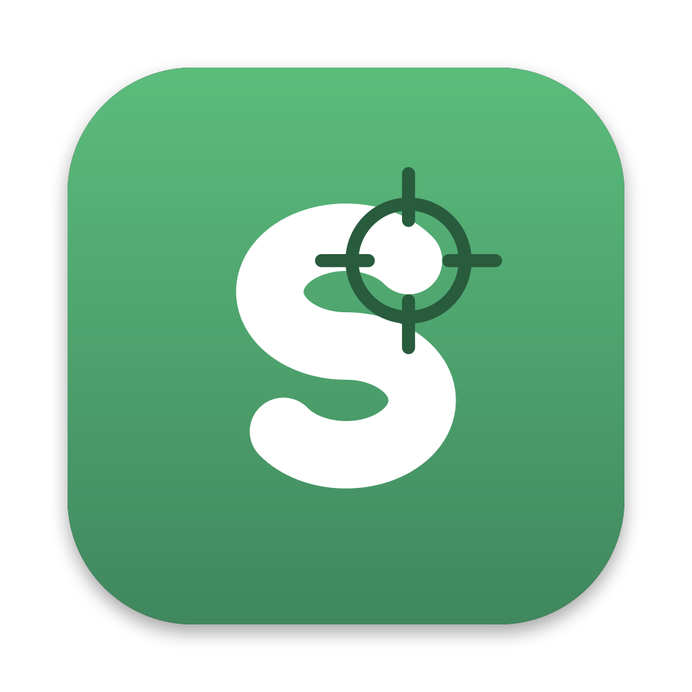

# sCapture



sCapture is a macOS menu bar agent that captures a screenshot of a profiled window, at a fixed size and scale, into the active case folder, and shows the step count. It does no editing (sNotate does) and no viewing (sView does); it is the first link of that chain.

## Why another screenshot tool

Shottr, CleanShot X and the macOS screenshot keys are fast, but they save to one folder at whatever scale the display has. Documenting a procedure step by step needs three things they do not do:

- The destination is the active case folder, switched from the menu, with the step count in the menu bar; a capture never has to be moved afterwards.
- Geometry is a profile: the window is placed at a fixed position and size and captured at a fixed scale, so every capture of a case has the same pixel size, on a Retina display or not.
- Names sort in capture order (`scap-2026-10-30-093435.png`, a second capture in the same second gets `b`), or are final at once (`poc-demo-vm-stop-07.png`).

## Part of sSuite

sSuite is a small family of macOS tools that turn work done on screen into step-by-step evidence and guides, one job per tool, published under the [uSuite](https://github.com/uSuite) organization. The organization page explains why the family exists.

| Tool | Job |
| --- | --- |
| **sCapture** (this one) | captures a window at a fixed size and scale into the active case folder |
| [sView](https://github.com/uSuite/sview) | views images and walks case folders from the keyboard |
| [sNotate](https://github.com/uSuite/snotate) | annotates a case folder as one story and exports one image per step |
| sWalk | planned: renders a notated case as an animated step-by-step clip |
| [scommon](https://github.com/uSuite/scommon) | the Swift package the tools share: folders, sorting, config and keymap |

sCapture is the first link: every capture of a procedure lands in its case folder at the same pixel size, named in capture order, so sView can flip through it and sNotate can annotate it as one story without resizing or moving a file.

## Install

Requires macOS 26 or newer, on Apple silicon or Intel. Download `sCapture-<version>.zip` from the [latest release](https://github.com/uSuite/scapture/releases/latest), open it, and move `sCapture.app` to Applications. sCapture lives in the menu bar; choose Launch at Login in its menu to keep it running.

### The first open: sCapture Not Opened

The release is signed ad hoc, not with a paid Apple Developer ID, so Apple has not notarised it. The first time you open a downloaded copy, macOS stops it with "Apple could not verify sCapture is free of malware". Choose Done, then allow it once, either way:

- System Settings > Privacy & Security, scroll down to Security, and next to the line saying sCapture was blocked to protect your Mac, choose Open Anyway, confirm with your password or Touch ID, then Open.
- Or in Terminal, remove the download flag macOS checks: `xattr -dr com.apple.quarantine /Applications/sCapture.app`

From then on that copy opens like any app; each new version you download asks once more. A copy you build yourself never carries the download flag.

### Permissions, and again after every update

sCapture needs Screen Recording to capture (macOS asks on first launch) and Accessibility to place windows (asked the first time a profile places one; without it the window is captured where it is). Both are in System Settings > Privacy & Security, and the menu has a row for each one that is missing.

macOS ties both grants to the app's signature. An ad hoc signed update is a new signature, so after every update remove sCapture from both lists and add it again (or switch it off and on), then quit and reopen it. This goes away once releases are notarised.

## Use

1. Make a case: menu > New Case…, a lower-case id such as `poc-demo-vm-stop`. Cases are the folders under the root (`~/Pictures/scapture` by default); the menu lists them, newest first, and picks one as active.
2. Pick a profile in the menu, or with `ctrl-alt-1` to `ctrl-alt-9`. `front-window` captures whatever window is in front at 2x; `console-chrome` places Chrome and leaves out its title bar, tabs and address bar.
3. Press `ctrl-shift-5`. The window snaps to the profile's frame, the captured rect flashes, and a toast shows the thumbnail, the step number and the pixel size; click it to open the capture in sNotate or sView. `ctrl-shift-r` captures the same window again.

The menu bar shows `<case>  <count>  <profile>`. The full key list is in [docs/keys.md](docs/keys.md); every capture is a line in `~/.config/scapture/log`.

## Configure

Everything is plain text in `~/.config/scapture/`, written with comments on first run and reloaded when it changes: `config` (root folder, `name timestamp` or `case-step`, `auto_position`, `settle_ms`, `flash`, `toast`), `keymap` (the global keys) and `profiles`. A profile is a block:

```
profile console-chrome
app com.google.Chrome
origin 200 50
size 1520 980
inset 87 1 1 1
scale 2
```

`app` is a bundle id, an app name or `frontmost`; `window` (optional) is part of the window title. `origin` and `size` place the window, in points from the top-left of the main display; without them the window is captured where and as it is. `inset` cuts points off the top, left, bottom and right. The output is always `(size - inset) x scale` pixels, here 3036 x 1784, whatever the display. Problems in any file are listed in the menu.

## Build

`make test`, `make app`, `make run`, `make smoke` (needs Screen Recording for the built app). Swift 6.2 and macOS 26 or newer, Apple frameworks only, shared code from [scommon](https://github.com/uSuite/scommon). The design lives in [docs/02-tech-stack.md](docs/02-tech-stack.md), the backlog in [docs/01-backlog.md](docs/01-backlog.md), the plan in [docs/03-roadmap.md](docs/03-roadmap.md) and the decisions in [docs/DECISIONS.md](docs/DECISIONS.md). `scripts/poc.sh` is the shell proof of concept the app grew from.

## Licence

MIT, see [LICENSE](LICENSE).
